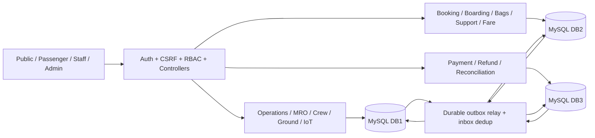

# Kiến trúc thực thi

Laravel 12/PHP 8.4, Blade/Bootstrap 5. Modular Monolith: controller/validation → domain service → query repository/connection. Không microservices giả tạo, không FK/join xuyên instance. Query local sử dụng builder/parameter binding.

## Ownership

DB1: airports/routes/resources/aircraft/flights, crew assignments, work orders, allocations, ground tasks, disruptions, flight_changes/change_reservations, devices/telemetry, master revisions, outbox/inbox/audit. DB2: auth/users, inventory/fares, booking/ticket/QR, exchanges, aircraft_change_receipts/seat_reassignments, baggage/events, support/messages/notifications, outbox/inbox/audit. DB3: payments/refunds/ledger/reconciliation, outbox/inbox/audit. Ba container/volume và server UUID độc lập.

## Giao diện và truy cập

Khách hàng có tìm/đặt vé, hành trình, chứng từ in, hỗ trợ và thông báo. Nhân viên có bàn làm việc theo vai trò; chọn tên/mã nghiệp vụ thay cho nhập UUID/ID. Nhân viên sân bay chỉ tra cứu/làm thủ tục và in thẻ trong sân bay được gán. Admin tạo nhân viên bằng mật khẩu tạm, bắt đổi ở lần đầu; khóa tài khoản làm mất quyền truy cập ngay ở yêu cầu kế tiếp. API và service vẫn kiểm tra quyền/ownership độc lập với hiển thị.

OTP/link xác minh, reset và thông báo nghiệp vụ dùng database queue `mail` và ShouldBeEncrypted. OTP lưu hash trong DB2 email_verifications, có hạn 10 phút/5 lần thử, resend 60 giây và vô hiệu mã cũ. Mailpit là SMTP/inbox phụ trợ local, không sở hữu dữ liệu nghiệp vụ. Worker email riêng thử lại 5 lần, không giữ HTTP đăng ký chờ SMTP. Worker nghiệp vụ vẫn xử lý expiry/outbox độc lập. Đổi SMTP/merchant cần khởi động lại worker; không công khai nội dung job hoặc khóa bí mật trong giao diện.

## Thanh toán nhà cung cấp và ngân hàng

DB2 checkout_sessions giữ yêu cầu và chỉ dẫn đã chiếu; DB3 checkout_intents sở hữu giao dịch với VNPay/MoMo/ngân hàng. Nhánh simulator cũ tắt mặc định. Local dùng provider Mock có cùng quy trình intent/chữ ký/outbox; Mock và bootstrap admin đều bị chặn trong production. Phương thức chưa cấu hình không được mở cho khách. Tên miền cổng/HTTPS được kiểm tra; TLS luôn được xác minh với CA bundle được gắn chỉ đọc.

CheckoutRequested ghi cùng transaction khóa booking/inventory. Đích lưu intent bền trước khi gọi nhà cung cấp; request/order ID cố định qua retry, kể cả khi tạo thanh toán timeout. VNPay ký query HMAC-SHA512; MoMo ký yêu cầu HMAC-SHA256. IPN đọc dữ liệu nguyên bản để middleware trim/đổi chuỗi rỗng không làm sai chữ ký, kiểm tra merchant/order/amount, commit tài chính và trả lời nhanh. Return từ trình duyệt không capture. PaymentResult đi qua outbox hiện có để xuất vé đúng một lần. Callback tới trước phản hồi tạo thanh toán vẫn có intent để ghi nhận, không bị mất khi request tạo timeout.

Chuyển khoản chỉ capture khi finance xác nhận sao kê với mã giao dịch duy nhất. Đổi vé thật tạo checkout cho khách thanh toán vé mới thay vì tự giả lập thu. Khoản hoàn thật luôn chờ phê duyệt và chi ngân hàng; destination được mã hóa/hash để nhận lại cùng nội dung không hủy approval, thay đổi nội dung phải duyệt lại. Người xác nhận chi khác approver, mã giao dịch chi duy nhất; chỉ sau đó ghi REFUNDED/ledger/outbox. Hủy chuyến không tự đánh dấu tiền thật đã hoàn. Không có hoàn API trực tiếp vào ví/thẻ.

## Local consistency

- Inventory flight row là điểm serialization cho hold, TTL, check-in, fare quota, đổi chuyến, refund/cancel và boarding. Ghế có unique(flight,seat); vé/payment unique booking; QR random 256 bit, lookup SHA256, token lưu mã hóa bằng APP_KEY.
- Đổi giữ chỗ khóa hai inventory theo ID tăng dần, không kéo dài TTL. Hạng giá là fare bucket dùng chung cabin, có quota riêng nhưng tổng tồn toàn chuyến vẫn chặn oversell.
- Lịch publish khóa airport/aircraft/flight và crew, kiểm tra turnaround 30 phút/rest 12h/license/qualification; gate allocation kiểm tra giao thời gian. Publish batch là một transaction DB1, một lỗi rollback cả đợt và các event.
- Bảo dưỡng giữ aircraft lock trước release; chỉ AVAILABLE khi mọi lệnh đã RELEASED. ARRIVED cộng giờ/cycles một lần qua state machine.
- Resource [starts_at,ends_at) không giao nhau; tạo allocation dưới resource lock. Gỡ/đổi có lý do, version và event. Trễ khi còn allocations bị từ chối để người điều phối xử lý rõ.
- Master revision lưu before/after JSON. Duyệt kiểm tra source vẫn giống snapshot (canonical key order), approver độc lập. CSV airport nhập toàn bộ vào pending hoặc rollback, chưa có hiệu lực trước approval.
- Thay tổ bay sau công bố lưu snapshot/version và duyệt độc lập; khóa các crew theo ID, kiểm tra lại năng định/license/rest, chuyển assignment cũ sang inactive rồi kích hoạt danh sách mới trong cùng transaction DB1. Các kiểm tra lịch chỉ tính assignment đang active.

## Outbox/Saga

Mỗi mutation và outbox cùng local transaction. Relay khóa event, gửi qua service sang node đích. Đích ghi inbox(event_id) cùng hiệu ứng; source chỉ ack sau commit. Crash sau remote commit trước ack phát lại an toàn. Attempts/backoff tăng tới tối đa 60 giây mỗi lần chờ; không bỏ event chỉ vì timeout. Monitoring hiển thị pending/attempts/delivered. Không giả định distributed ACID hoặc globally atomic backup.

1. **FlightChanged DB1→DB2:** version mới tạo/cập nhật trạng thái inventory; version cũ/trùng không ghi đè. Booking dùng snapshot giá, trạng thái chuyến authoritative đọc DB1 trước giao dịch. Không tự đổi price booking đã tạo.
2. **Payment:** DB2 HELD còn hạn→PAYMENT_PENDING+PaymentRequested. DB3 xác nhận kết quả đã kiểm chứng, unique booking, ledger CAPTURE, PaymentResult outbox. Nhánh PaymentRequested/scenario chỉ dùng simulator trong DB test; người dùng đi qua CheckoutRequested. DB2 capture→CONFIRMED+vé unique, decline→CANCELLED giải phóng chỗ. PAYMENT_PENDING không bị expire mù.
3. **Refund:** chủ booking yêu cầu trước cutoff, QR thu hồi và REFUND_PENDING giữ tồn trong khi chờ. Với tiền thật, finance duyệt APPROVED rồi người khác xác nhận chi mới ghi DB3 REFUNDED+ledger âm+RefundResult; DB2 REFUNDED và thông báo. Reject phục hồi CONFIRMED, cần check-in lại. Event replay không refund lần hai.
4. **Paid exchange:** source vé trả→đề nghị có target hold TTL. Finance thấy cả hai số tiền và duyệt. DB2 freeze source EXCHANGE_PENDING, target PAYMENT_PENDING. Mua mới thành công mới hoàn cũ qua outbox, trạng thái REFUNDING→COMPLETED; mua mới decline phục hồi source CONFIRMED và FAILED. Hết TTL trước duyệt không thay đổi vé nguồn. Capture callback khóa các inventory theo thứ tự để tránh khóa đảo chiều.
5. **Disruption cancellation:** ops_manager độc lập duyệt CANCEL. DB2 chờ PAYMENT_PENDING/EXCHANGE_PENDING resolve trước bù trừ; HELD hủy; vé đã trả/checked-in/boarded chuyển refund, revoke QR, ghi offload bags, notify. DB3 auto refund theo phương án đã được duyệt. Nếu mất kết nối, event còn pending và phục hồi bằng retry.
6. **Aircraft swap:** chỉ cùng loại trước BOARDING; ops_manager độc lập duyệt snapshot/version còn đúng. DB1 giữ cả tàu cũ/mới qua change_reservations, flight CHANGE_PENDING và fence version. AircraftChangePrepare sang DB2 khóa tồn, đếm booking còn hiệu lực (kể cả tài chính pending), từ chối nếu đã boarding/thiếu chỗ/phiên bản cũ. Nếu đủ, receipt PREPARED + stock RECONFIGURING chặn mutation. READY về DB1 đổi plan COMMITTING rồi gửi AircraftChangeCommit; DB2 giữ ghế còn hợp lệ, remap phần còn lại, xoay QR của mọi CHECKED_IN, ghi mapping/audit/notice cùng transaction và trả COMMITTED. DB1 mới đổi aircraft thực, tăng version, trả trạng thái cũ, giải phóng hai reservation và phát FlightChanged cuối. DB2 chỉ bỏ frozen_change_id khi receipt COMMITTED và version vượt fence. Trước đó check-in/boarding/bán/đổi/hoàn bị chặn; callback tài chính được retry. Expire vẫn được phép để worker không kẹt trước bước relay. Replay không tạo thêm QR/mapping. Chuẩn bị bị từ chối thì DB1 giữ tàu cũ, QR/ghế không đổi. Không có timeout tự ý mở khóa khi kết quả chưa rõ.

Trần bán sau đổi tàu là min(trần bán cũ, sức chứa mới), quota hạng giá không vượt trần. manual_closed tách khỏi trạng thái vận hành để sự kiện hoàn tất không mở một chuyến đã đóng bán thủ công. Reservation cũng chặn publish chuyến khác, MRO và sửa cấu hình tàu; phân bổ tài nguyên, thay tổ bay và duyệt delay/cancel không được ghi đè flight đang đổi tàu.

## QR, IoT, privacy

QR SVG chứa opaque token, không PII; board kiểm tra role/sân bay/chuyến/time/status/revocation/used. Đổi ghế hoặc cấp lại thay token; mã cũ bị từ chối. No-show/offload cần actor/reason, revoke và custody events. Baggage transition kiểm tra thứ tự, điểm đi/đến, event payload replay; không coi quét là điều khiển thiết bị thật.

IoT validate event ID/sequence/time, lưu event time và received time UTC. Late/out-of-order không cập nhật latest. Duplicate cùng payload replay; cùng ID/sequence payload khác trả conflict. AI là rules-demo-v1 có giải thích, không mô hình huấn luyện hoặc phê duyệt quyết định.

Auth: session regeneration/logout invalidation, hash password, email signed links, reset một lần; cookie HttpOnly/SameSite; CSRF cho cả API mutations; Blade escaping/CSP; rate limiting, ownership, CSV formula escaping, secrets ignored. SMTP qua worker mail có retry; cấu hình mặc định chưa kết nối nhà cung cấp, log chỉ dành cho phát triển. Production cần HTTPS/secure cookies, SMTP, SSO/MFA, secret manager, external audit sink, HA/DR/load/UAT và quy tắc hãng được chứng nhận.

## Cấu hình local

Toàn bộ mật khẩu, APP_KEY và merchant key sinh ngẫu nhiên được lưu riêng trong backend/.env; root .env là symlink cho Compose dùng cùng giá trị. Migrate cấu hình giữ credential có hiệu lực của Compose và setup lặp không đổi key/password. Bootstrap chỉ tạo admin đầu tiên từ .env trên local, không nâng quyền tài khoản trùng email hoặc ghi đè admin đã có; lần đầu bắt đổi mật khẩu. APP_URL là URL gốc cho mail/payment; TRUSTED_PROXIES chỉ nạp sau bootstrap config để hỗ trợ TLS proxy đúng thời điểm.

Checkout/payment lưu mode để phân biệt mock/gateway/live/simulator. Local Mock VNPay/MoMo dùng server amount, ownership, CSRF, callback ký bằng key trong .env và pipeline tài chính/outbox hiện có; không gọi cổng ngoài. Bank mock có thông tin giả từ .env và chờ finance xác nhận. Chuyển dịch vụ thật chỉ đổi cấu hình; không coi dữ liệu thử nghiệm là sổ tiền thật.
