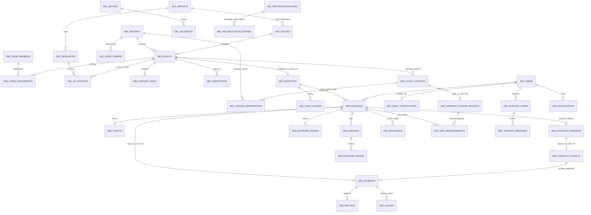

# ERD theo node

Các đường nối giữa node là tham chiếu logic qua backend/event, không FK xuyên MySQL server.

Mỗi node có outbox/inbox/audit_logs. DB1 có master_changes và flight_changes lưu snapshot/version approval; crew_assignments.active giữ phân công cũ, còn snapshot phương án lưu lịch sử trước/sau. DB2 có booking_changes cho idempotency đổi giữ chỗ; inventory.frozen_change_id/manual_closed kiểm soát đóng băng và đóng bán thủ công khi đổi tàu. Các bảng users/session/cache/jobs scaffold ở DB2, chỉ file-session/cache được chọn trong dev. Migration là nguồn chính xác về kiểu/ràng buộc; không vẽ các bảng chưa tồn tại như đã triển khai.
