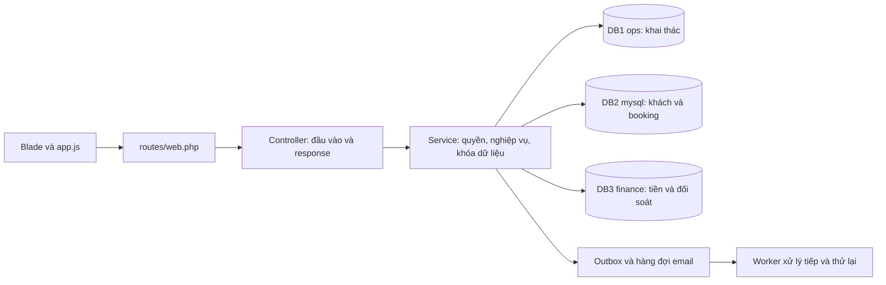

# Hướng dẫn trình bày chức năng qua giao diện và code

Tài liệu dùng cho báo cáo hoặc demo phiên bản hiện tại của Airline Smart. Trình bày theo luồng sử dụng, sau đó mở các đoạn code thực hiện đúng thao tác vừa demo. Bảng 20 phân hệ ở cuối là bản đồ tra cứu; không phải xác nhận đã hoàn thiện mọi yêu cầu trong DOCX.

## 1. Cách trình bày một chức năng

Mỗi chức năng đi theo cùng thứ tự:

| Bước | Nội dung trình bày | Minh chứng |
|---|---|---|
| 1. Mục đích và người dùng | Giải quyết việc gì, ai được sử dụng | Tên vai trò và màn hình |
| 2. Thao tác giao diện | Nhập gì, bấm gì, kết quả thay đổi ra sao | Một tình huống thành công trên trình duyệt |
| 3. Đường xử lý | Request đi đến đâu, controller gọi service nào | Route → controller → hàm nghiệp vụ |
| 4. Dữ liệu | Đọc/ghi bảng nào, ở node nào | Migration hoặc bản ghi mẫu liên quan |
| 5. Quy tắc và tình huống lỗi | Quyền, thời hạn, điều kiện hợp lệ, chống xử lý lặp | Một trường hợp hệ thống từ chối |
| 6. Kiểm chứng và giới hạn | Đã kiểm tra điều gì, phần nào còn mô phỏng/chưa bao phủ | File test, tài liệu kiểm chứng |

Một câu dẫn có thể dùng:

> Chức năng này dành cho …, giúp …. Trên giao diện, người dùng …. Request được route chuyển đến …, sau đó service … kiểm tra …. Dữ liệu được lưu/đọc ở …. Kết quả là …. Nếu … thì hệ thống từ chối để bảo đảm ….

Mở sẵn khoảng 2–4 file chính cho mỗi luồng. Điểm cần giải thích trong code là điều kiện nghiệp vụ và cách bảo vệ dữ liệu, sau khi người xem đã thấy hành vi trên giao diện.

## 2. Giới thiệu cấu trúc dự án

FE hiện tại là Blade/Bootstrap và JavaScript thuần, nằm cùng dự án Laravel với backend:

```text
backend/
  resources/views/        Màn hình và thành phần giao diện Blade
  frontend/               Mã nguồn FE dùng chung
    app.css               Kiểu dáng giao diện và responsive components
    app.js                Bộ lọc, thanh kéo, hộp xem chuyến, thao tác trình duyệt
  public/app.css          Bản runtime được đồng bộ từ frontend/app.css
  public/app.js           Bản runtime được đồng bộ từ frontend/app.js
  routes/web.php          Route giao diện và API v1
  app/Http/Controllers/   Nhận request, kiểm tra đầu vào, trả view/JSON
  app/Modules/            Nghiệp vụ đặt vé, tài chính, khai thác, hỗ trợ...
  app/Support/            Phân quyền hiển thị, nhãn, form, dashboard, CSV
  database/migrations/    Cấu trúc dữ liệu ba node
  tests/                  Kiểm thử backend
tests/e2e/                Kiểm thử thao tác trình duyệt
```

Ví dụ giải thích:

> Giao diện và API dùng chung các service nghiệp vụ. Việc ẩn nút theo vai trò giúp người dùng thao tác, còn service tiếp tục kiểm tra quyền khi nhận request. Backend tổ chức nghiệp vụ theo các thư mục trong Modules.

Các file để mở: [routes](../backend/routes/web.php), [middleware](../backend/bootstrap/app.php), [phân quyền](../backend/app/Modules/Shared/Access.php), [cấu hình DB](../backend/config/database.php), [layout](../backend/resources/views/layouts/app.blade.php).



Ba node là ba kết nối MySQL độc lập, không đồng nghĩa với ba chức năng. Giao dịch trong một node dùng transaction/lock; các bước xuyên node được nối bằng outbox/inbox và worker. Không mô tả đây là một transaction SQL nguyên tử trên cả ba node.

## 3. Chuẩn bị demo

- Ứng dụng chính: `http://localhost:8000`; hộp mail local: `http://localhost:8025`. Cổng `18081` thuộc môi trường kiểm thử tạm thời và có thể đã dừng.
- Dùng các tài khoản trong [demo-data.md](demo-data.md): passenger, airport_agent, finance, customer_service, operations/ops_manager, admin. Mật khẩu lấy từ cấu hình local; phần trình chiếu dùng mã nguồn và dữ liệu mẫu, giữ credential ngoài màn hình.
- Chuẩn bị một hành trình một chiều, một hành trình khứ hồi, một vé đã thanh toán và một hồ sơ chờ duyệt. Mỗi đặt mới chỉ **một hành khách**; mỗi lượt có tối đa hai điểm dừng. PNR nhiều người trước đây là dữ liệu tương thích cũ.
- Chọn ngày còn lịch thực tế. Bộ dữ liệu nhiều hãng ban đầu có lịch 04–17/11/2026; xem [cách bổ sung ngày mới](multi-airline-demo.md) nếu đã qua khoảng này.
- Dùng môi trường thanh toán Mock để minh họa capture/từ chối. Chuyển khoản thật có QR/ngân hàng cấu hình riêng và chỉ được xác nhận khi thực nhận tiền.
- Check-in/boarding phụ thuộc thời gian. Chuẩn bị chuyến nằm đúng cửa sổ trước buổi demo; việc có vé đã trả không tự làm mở check-in hoặc boarding.

## 4. Kịch bản chính: từ khách hàng đến nhân viên

### 4.1. Đăng ký, OTP, đăng nhập và trang chủ

**Giao diện:** đăng ký → nhận email → nhập OTP → trang chủ; mở thêm quên mật khẩu nếu có thời gian. Local dùng Mailpit để xem mail. Đăng nhập thông thường vào `/home`; đang đặt dở có thể quay lại bản nháp.

**Code mở theo thứ tự:**

1. [auth.blade.php](../backend/resources/views/auth.blade.php), [verify.blade.php](../backend/resources/views/verify.blade.php), [home.blade.php](../backend/resources/views/home.blade.php).
2. [AuthController](../backend/app/Http/Controllers/AuthController.php): `register()`, `login()`, `authenticatedLanding()`.
3. [EmailVerification](../backend/app/Modules/Customer/EmailVerification.php): `issue()` và `verify()`; [VerifyEmail](../backend/app/Notifications/VerifyEmail.php) tạo nội dung email và chọn queue `mail`.
4. [HomeController](../backend/app/Http/Controllers/HomeController.php) lấy thông tin cho trang chủ.

**Giải thích:** OTP sinh 6 số, lưu hash, hết hạn sau 10 phút; có giới hạn thử và gửi lại. Người chưa xác minh bị chặn ở các thao tác cần xác minh. Mail đi qua database queue, cần worker. SMTP thật là phần cấu hình triển khai, không phải bằng chứng đã gửi thành công chỉ từ việc có form OTP.

**Dữ liệu:** DB2 `users`, `email_verifications`, `jobs`.

**Tình huống kiểm tra:** nhập sai mã; gửi lại quá sớm; đăng nhập để vào đúng trang chủ.

**Kiểm chứng:** [LocalServicesTest](../backend/tests/Feature/LocalServicesTest.php), [HomePageTest](../backend/tests/Feature/HomePageTest.php), [journey.spec.js](../tests/e2e/journey.spec.js).

### 4.2. Tìm chuyến và các bộ lọc

**Giao diện:** vào `/`, chọn tuyến/ngày; lần lượt tích hãng, số điểm dừng, giờ đi/đến và hạng giá. Kéo hai nút trên một thanh để chọn khoảng giá, quá cảnh và hành trình; đổi sắp xếp, sang trang 2 và đặt lại bộ lọc.

**Code mở theo thứ tự:**

1. [flights.blade.php](../backend/resources/views/flights.blade.php), [flight-search-results](../backend/resources/views/partials/flight-search-results.blade.php), [flight-range](../backend/resources/views/partials/flight-range.blade.php), [flight-result-card](../backend/resources/views/partials/flight-result-card.blade.php).
2. [frontend/app.js](../frontend/app.js): tìm `data-flight-search`, `updateRange`, `pointerdown`, `refresh` và `search`; [frontend/app.css](../frontend/app.css) điều khiển hình thức. Bản runtime tương ứng nằm trong `backend/public/` sau khi chạy `npm run assets`.
3. Route `GET /` → [PortalController::flights()](../backend/app/Http/Controllers/PortalController.php) → [FlightSearch::search()](../backend/app/Modules/Flights/FlightSearch.php).
4. Trong `FlightSearch`, giải thích `filterFlight()`, `journeys()` và `globalRanges()`.

**Giải thích:** backend lọc và sắp xếp trước khi phân trang 8 lịch trình. Nối chuyến ghép từ các chuyến thật trong DB, cùng sân bay, không lặp sân bay, có thời gian chờ hợp lệ. Giá hành trình cộng các chặng ở cùng hạng; hãng lấy theo từng chuyến. Dữ liệu tên hãng/lịch/giá mẫu chưa kết nối bán vé với hãng.

Mốc min/max ba thanh lấy từ mọi hành trình đã công bố chưa khởi hành trên mọi tuyến/ngày/hạng, gồm nối chuyến hợp lệ. Đổi điều kiện tìm không đổi các mốc; khoảng đang chọn vẫn lọc kết quả. Quá cảnh là tổng thời gian chờ, bay thẳng bằng 0; hành trình gồm cả bay và chờ. `globalRanges()` dùng khóa cache theo nội dung lịch/giá để cập nhật khi nguồn đổi.

**Dữ liệu:** DB1 `flights`, `aircraft`, `airports`; DB2 `inventory`, `fare_classes`, `bookings` để tính tồn.

**Tình huống kiểm tra:** một khoảng không có kết quả; đổi tuyến mà mốc toàn hệ thống giữ nguyên; phản hồi cũ không ghi đè bộ lọc mới.

**Kiểm chứng:** [FlightSearchTest](../backend/tests/Feature/FlightSearchTest.php), [GlobalFlightRangesTest](../backend/tests/Feature/GlobalFlightRangesTest.php), [flight-ranges.spec.js](../tests/e2e/flight-ranges.spec.js).

### 4.3. Bấm Chọn, xem lịch trình và nhập hành khách

**Giao diện:** bấm Chọn → hộp thông tin chuyến → Tiếp tục → thông tin hành khách/liên hệ. Với khứ hồi: chọn lượt đi, chọn lượt về, xem cả hai lượt rồi nhập thông tin. Đóng hộp và chọn lại để minh họa rằng bước xem trước chưa giữ chỗ.

**Code mở:** [TripController](../backend/app/Http/Controllers/TripController.php): `select()`, `preview()`, `passengers()`, `store()`; [TripSelection](../backend/app/Modules/Booking/TripSelection.php): `encode()`, `decode()`, `quote()`; [trip-preview](../backend/resources/views/partials/trip-preview.blade.php), [trip-preview-direction](../backend/resources/views/partials/trip-preview-direction.blade.php), [trip-passengers](../backend/resources/views/trip-passengers.blade.php).

**Giải thích:** lựa chọn được mã hóa, backend kiểm tra lại giá/chỗ. Nhập thông tin mới tạo PNR khi bấm Tiếp tục và đã đáp ứng đăng nhập/xác minh. Một chiều có lịch trình lượt đi; khứ hồi có cả hai lượt; hãng có thể khác giữa hai lượt.

**Tình huống kiểm tra:** thông tin thiếu; lựa chọn hết hiệu lực; giá/chỗ thay đổi trước khi xác nhận.

**Kiểm chứng:** [TripBookingFlowTest](../backend/tests/Feature/TripBookingFlowTest.php), [multi-airline.spec.js](../tests/e2e/multi-airline.spec.js), [reservations.spec.js](../tests/e2e/reservations.spec.js).

### 4.4. Tạo PNR, giữ chỗ và mua hành lý

**Giao diện:** sau thông tin khách, mở trang `/reservations/{id}`; xem mã chung, các vé thành phần, hạn giữ chỗ và tổng tiền. Chọn gói hành lý trước thanh toán, đối chiếu tổng tiền thay đổi.

**Code mở:** [ReservationService::hold()](../backend/app/Modules/Booking/ReservationService.php), [BookingService](../backend/app/Modules/Booking/BookingService.php), [BaggagePurchase::update()](../backend/app/Modules/Booking/BaggagePurchase.php), [reservation.blade.php](../backend/resources/views/reservation.blade.php), [baggage-package](../backend/resources/views/business/baggage-package.blade.php).

**Giải thích:** một người × nhiều chuyến thành phần vẫn dùng một PNR. Service khóa tồn các chuyến theo thứ tự, kiểm tra tổng chỗ/quota/cabin và tạo các vé thành phần trong transaction DB2. Giữ chỗ có hạn 10 phút, thao tác lặp dùng idempotency key. Mua hành lý cập nhật giá từng vé và tổng PNR; đã bắt đầu checkout thì không đổi tổng tiền qua chức năng này.

**Dữ liệu:** DB2 `reservations`, `reservation_passengers`, `reservation_segments`, `bookings`, `inventory`, `fare_classes`. [TripDetails](../backend/app/Modules/Booking/TripDetails.php) mã hóa giấy tờ/liên hệ.

**Tình huống kiểm tra:** hết chỗ ở một chặng làm lần giữ toàn hành trình thất bại; sửa gói sau checkout bị từ chối; giữ chỗ hết hạn.

**Kiểm chứng:** [ReservationTest](../backend/tests/Feature/ReservationTest.php), [BusinessFeaturesTest](../backend/tests/Feature/BusinessFeaturesTest.php).

### 4.5. Thanh toán và phát hành vé

**Giao diện:** chọn phương thức trong PNR, hoàn tất luồng Mock, quay lại thấy vé đã phát hành. Mở từng vé và chứng từ. Với chuyển khoản, minh họa trang nhân viên đối chiếu hoặc nhập CSV sao kê.

**Code mở:** [ReservationController::pay()](../backend/app/Http/Controllers/ReservationController.php), [ReservationService::pay()](../backend/app/Modules/Booking/ReservationService.php), [CheckoutService](../backend/app/Modules/Finance/CheckoutService.php), [GatewayPayments](../backend/app/Modules/Finance/GatewayPayments.php), [OutboxRelay](../backend/app/Modules/Finance/OutboxRelay.php), [partials/checkout](../backend/resources/views/partials/checkout.blade.php).

**Giải thích:** một yêu cầu thanh toán bao gồm tổng hành trình và phân bổ cho từng vé. Kết quả phía server được xác minh trước khi ghi thu/xuất vé; trang return của trình duyệt không đủ để xác nhận đã thu. Callback lặp không tạo thu/vé lần hai. Worker chuyển kết quả giữa DB3 và DB2.

**Dữ liệu:** DB2 `checkout_sessions`, `bookings`, `tickets`, `outbox`, `inbox`; DB3 `checkout_intents`, `payments`, `ledger_entries`, `outbox`, `inbox`.

**Tình huống kiểm tra:** thanh toán bị từ chối; callback gửi lại; thông báo khách đã chuyển khoản nhưng tài chính chưa xác nhận thì chưa phát hành vé.

**Kiểm chứng:** [PaymentGatewayTest](../backend/tests/Feature/PaymentGatewayTest.php), [BankTransferQrCheckoutTest](../backend/tests/Feature/BankTransferQrCheckoutTest.php), [local-services.spec.js](../tests/e2e/local-services.spec.js).

### 4.6. Check-in, QR, boarding và chốt danh sách

**Giao diện:** khách mở `/journeys/{id}`, chọn ghế và check-in; nhân viên sân bay mở `/staff`, chọn chuyến, quét QR. Quét lại để thấy chống dùng trùng. Trong `/workspace/boarding-control`, minh họa khóa/mở check-in và danh sách đã chốt.

**Code mở:** [BoardingService](../backend/app/Modules/Boarding/BoardingService.php): `checkin()`, `board()`; [SeatMap](../backend/app/Modules/Boarding/SeatMap.php); [BoardingOperations](../backend/app/Modules/Boarding/BoardingOperations.php): `control()`, `finalize()`, `read()`; [staff.blade.php](../backend/resources/views/staff.blade.php), [boarding-control](../backend/resources/views/business/boarding-control.blade.php).

**Giải thích:** kiểm tra chủ vé, vé đã trả, cửa sổ check-in, ghế còn trống/đúng khoang. QR là token ngẫu nhiên, kiểm tra đúng chuyến/sân bay/thời hạn và chống quét trùng. Danh sách chốt có phiên bản; bản cũ giữ nguyên, dữ liệu thay đổi phải chốt lại khi cần. Chốt sau đóng cửa và xử lý hết khách check-in chưa boarding/no-show.

**Dữ liệu:** DB2 `boarding_passes`, `bookings`, `boarding_manifests`; DB1 cấu hình check-in trong `flights`.

**Tình huống kiểm tra:** quét lại QR; chọn sai chuyến; check-in khi cửa đang khóa. Cửa sổ mặc định check-in -24h đến -30 phút, boarding -60 đến -10 phút là quy tắc ứng dụng thử nghiệm.

**Kiểm chứng:** [JourneyTest](../backend/tests/Feature/JourneyTest.php), [CabinConfigurationTest](../backend/tests/Feature/CabinConfigurationTest.php), [BusinessFeaturesTest](../backend/tests/Feature/BusinessFeaturesTest.php), [journey.spec.js](../tests/e2e/journey.spec.js).

### 4.7. Nhân viên duyệt và xử lý sau bán

Có thể chọn hai tình huống sau để chứng minh phối hợp vai trò:

| Tình huống | Thao tác giao diện | Code cần giải thích |
|---|---|---|
| Sửa thông tin sau xuất vé | Khách gửi tại `/reservations/{id}/details`; CS mở `/workspace/passenger-revisions` và duyệt | [ReservationEdits](../backend/app/Modules/Booking/ReservationEdits.php): fingerprint, dữ liệu mã hóa, người duyệt, thu hồi QR nếu đổi định danh |
| Điều kiện đổi/hoàn | Data admin sửa `/workspace/fare-rules`; khách xem điều kiện đã lưu trên vé | [FareRules](../backend/app/Modules/Booking/FareRules.php): snapshot; [ExchangeService](../backend/app/Modules/Booking/ExchangeService.php), [FinanceService](../backend/app/Modules/Finance/FinanceService.php): phí, hạn, mua vé mới trước khi hoàn cũ |
| Sao kê và báo cáo | Finance nhập CSV ở `/workspace/bank-statements`, kiểm tra dòng khớp, xác nhận; xem `/workspace/revenue` | [FinanceOperations](../backend/app/Modules/Finance/FinanceOperations.php): import/match/confirm; [RevenueReport](../backend/app/Modules/Finance/RevenueReport.php): ngày ghi sổ Việt Nam, thu−hoàn+điều chỉnh |
| Điều chỉnh độc lập | Finance A lập `/workspace/financial-adjustments`; finance B duyệt | `FinanceOperations::adjustment()` / `decideAdjustment()`: không tự duyệt, kiểm tra phiên bản sổ và chỉ ghi một bút toán |
| Hỗ trợ quá hạn | Khách gửi yêu cầu; CS phân công ở `/workspace/support-desk`, đặt hạn và phản hồi | [CustomerService](../backend/app/Modules/Customer/CustomerService.php), [SupportDesk](../backend/app/Modules/Customer/SupportDesk.php): người được giao, UTC/giờ Việt Nam, nâng ưu tiên quá hạn |
| Chuyến bị gián đoạn | Operations lập, ops_manager duyệt, khách mở thông báo phương án thay thế | [PassengerRecovery](../backend/app/Modules/Operations/PassengerRecovery.php): khách/chuyến nối/nguồn lực, kiểm tra lại giá/chỗ, duyệt độc lập |

Các màn hình mới được [BusinessController](../backend/app/Http/Controllers/BusinessController.php) điều phối. `action()` ánh xạ action sang service; view nằm trong `backend/resources/views/business/`. Chi tiết ở [8 nhóm nghiệp vụ](eight-business-features.md); kiểm chứng bằng [BusinessFeaturesTest](../backend/tests/Feature/BusinessFeaturesTest.php) và [business.spec.js](../tests/e2e/business.spec.js).

## 5. Bản đồ 20 phân hệ: giao diện và code

`WorkspaceController::sections()` xác định menu theo vai trò; `index()` chuẩn bị bảng/form; `dispatch()` nhận action và gọi service. Nhiều màn hình dùng chung [workspace.blade.php](../backend/resources/views/workspace.blade.php), [WorkspaceForms](../backend/app/Support/WorkspaceForms.php) và [WorkspacePresentation](../backend/app/Support/WorkspacePresentation.php). Các trang nghiệp vụ mới tách view riêng và dùng `BusinessController`.

| Phân hệ | Giao diện/vai trò để demo | Code chính và dữ liệu |
|---|---|---|
| M01 – Danh mục sân bay | `/workspace/catalog`; data_admin | [OperationsService](../backend/app/Modules/Operations/OperationsService.php), [MasterDataService](../backend/app/Modules/Operations/MasterDataService.php), [MasterFileService](../backend/app/Modules/Operations/MasterFileService.php); DB1 `airports`, `routes`, `airport_resources`, `master_changes`. CSV nhập hiện dành cho sân bay |
| M02 – Lịch bay | `/workspace/scheduling`; operations lập/trình, ops_manager duyệt | `OperationsService::execute()`: schedule/season/submit/publish; DB1 `flights`, phân công; sự kiện mở tồn ở DB2 |
| M03 – Điều hành chuyến | Cập nhật khai thác trong `/workspace/scheduling` | `OperationsService`: flight_state; DB1 trạng thái/giờ thực tế, kiểm tra việc mặt đất và khách chưa xử lý |
| M04 – Đội tàu/cabin | `/workspace/fleet`, `/workspace/fleet-cabin`; fleet_manager | [CabinController](../backend/app/Http/Controllers/CabinController.php), `SeatMap`, `MasterDataService`; DB1 `aircraft`, DB2 snapshot `inventory.seat_layout` |
| M05 – Bảo dưỡng | `/workspace/maintenance`; maintenance | `OperationsService`: work_order/complete_work/release_work; DB1 `work_orders`, `aircraft`. Người khác giải phóng tàu |
| M06 – Tổ bay | `/workspace/crew`; crew_scheduler/ops_manager | `OperationsService`, [FlightChangeService](../backend/app/Modules/Operations/FlightChangeService.php); DB1 `crew_members`, `crew_assignments` |
| M07 – Khách hàng | `/profile`, sửa thông tin PNR, tra cứu `/staff/passengers` | `AuthController`, [PassengerDeskController](../backend/app/Http/Controllers/PassengerDeskController.php), `ReservationEdits`; DB2 `users`, `reservation_passengers`, `passenger_revisions` |
| M08 – Đặt chỗ/vé | `/`, preview, `/trip/passengers`, `/reservations/{id}`, `/journeys` | `TripController`, `TripSelection`, `ReservationService`, `BookingService`, `ExchangeService`; DB2 PNR/bookings/tickets |
| M09 – Check-in/boarding | `/journeys/{id}`, `/staff`, `/workspace/boarding-control` | `BoardingService`, `PassengerChanges`, `BoardingOperations`; DB2 QR/ghế/manifest; DB1 cửa sổ check-in |
| M10 – Hành lý | Gói mua thêm trên PNR; `/workspace/baggage`, `/baggage/{id}` | [BaggagePurchase](../backend/app/Modules/Booking/BaggagePurchase.php), [BaggageService](../backend/app/Modules/Baggage/BaggageService.php); DB2 `baggage`, `baggage_events` và phí trên vé |
| M11 – Dịch vụ mặt đất | `/workspace/ground`; operations giao, ground_agent thực hiện | `OperationsService`: ground_task/ground_state; DB1 `ground_tasks`, hạn và evidence |
| M12 – Thanh toán/doanh thu | Thanh toán PNR, `/workspace/finance`, `/workspace/bank-statements`, `/workspace/revenue` | `CheckoutService`, `GatewayPayments`, `FinanceOperations`, `RevenueReport`; DB3 checkout/payment/refund/ledger/statement |
| M13 – Chăm sóc/thông báo | `/workspace/customer`, `/support/{id}`, `/workspace/support-desk`, `/workspace/notifications` | `CustomerService`, `SupportDesk`, [Events](../backend/app/Modules/Shared/Events.php), `ServiceMessage`; DB2 hồ sơ/hội thoại/notifications/mail queue |
| M14 – Phân tích/AI mô phỏng | `/workspace/analytics`; analyst/operations/ops_manager | [AnalyticsService::forecast()](../backend/app/Modules/Analytics/AnalyticsService.php) và phần analytics trong `WorkspaceController`; đọc dữ liệu khai thác/booking/cảnh báo. Forecast hiện theo luật |
| M15 – IoT mô phỏng | `/workspace/iot`; integration_admin | `AnalyticsService::device()` / `telemetry()`; DB1 `devices`, `telemetry`. Có CLI tạo sự kiện mô phỏng |
| M16 – Quản trị/tích hợp | `/staff` với admin, `/admin/connections`, `/workspace/audit`, `/workspace/integrations` | [AccountController](../backend/app/Http/Controllers/AccountController.php), `Access`, [Audit](../backend/app/Modules/Shared/Audit.php), [OutboxRelay](../backend/app/Modules/Finance/OutboxRelay.php); tài khoản DB2, audit/inbox/outbox theo node |
| M17 – Hạng giá/tồn | `/workspace/fare`, `/workspace/fare-rules`; data_admin | `WorkspaceController::fare()` / `fareClass()`, [FareRules](../backend/app/Modules/Booking/FareRules.php), [CommerceRepository](../backend/app/Modules/Booking/CommerceRepository.php); DB2 `inventory`, `fare_classes`, snapshot trên `bookings` |
| M18 – Tài nguyên sân bay | `/workspace/resources`; operations | `OperationsService`: allocate/unallocate; DB1 `airport_resources`, `resource_allocations`, kiểm tra giao thời gian |
| M19 – Gián đoạn/phương án | `/workspace/disruptions`, `/workspace/recovery`, `/workspace/passenger-recovery`; operations/ops_manager/crew_scheduler tùy action | `OperationsService`, `FlightChangeService`, [AircraftInventoryChange](../backend/app/Modules/Booking/AircraftInventoryChange.php), `PassengerRecovery`, [WorkflowRelay](../backend/app/Modules/Shared/WorkflowRelay.php); DB1 disruption/change, DB2 recovery/ghế/QR, DB3 hồ sơ hoàn |
| M20 – Đối soát/đóng kỳ | `/workspace/finance`, `/workspace/financial-adjustments`; finance | `FinanceService::reconcile()` / `close()`, `FinanceOperations`; DB3 `reconciliation_runs`, `reconciliation_entries`, `financial_adjustments`, `ledger_entries` |

## 6. Lịch trình báo cáo gợi ý 15–20 phút

| Thời lượng | Nội dung |
|---|---|
| 2 phút | Bài toán, vai trò, FE/BE và ba DB |
| 2 phút | Đăng nhập/OTP/trang chủ và code xác minh |
| 4 phút | Tìm/lọc, preview, khứ hồi, thông tin khách; mở controller/service tương ứng |
| 3 phút | PNR, giữ chỗ, hành lý, thanh toán Mock và vé; giải thích lock/outbox |
| 3 phút | Check-in, quét lại QR, chốt danh sách |
| 3 phút | Một quy trình duyệt độc lập: sửa khách hoặc điều chỉnh tài chính; thêm báo cáo doanh thu |
| 1–3 phút | Vai trò còn lại qua bản đồ module, kiểm chứng và phạm vi phát triển tiếp |

Nếu báo cáo ngắn hơn, giữ luồng khách đặt vé → thanh toán → nhân viên check-in/boarding, dùng bản đồ module làm phụ lục cho các chức năng khác.

## 7. Những câu hỏi code thường gặp

| Câu hỏi | Cách giải thích theo code hiện tại |
|---|---|
| FE nằm ở đâu? | Blade ở `backend/resources/views`; mã nguồn FE dùng chung ở `frontend/`; `npm run assets` đồng bộ CSS/JS sang `backend/public` để Laravel phục vụ |
| Tại sao chỉ ẩn nút chưa đủ? | Request vẫn có thể gửi trực tiếp; middleware và `Access::role/airport` cùng service kiểm quyền lần nữa |
| Hai người giữ ghế cuối cùng thì sao? | Inventory lock, kiểm tra lại tồn/quota/cabin trong transaction; idempotency giải quyết gửi lại cùng yêu cầu |
| Vì sao bấm Chọn chưa tạo booking? | Đây là preview/báo giá; tạo PNR tại bước xác nhận thông tin, tránh giữ chỗ chỉ vì xem chi tiết |
| Vì sao có nhiều vé trong một PNR một người? | Mỗi chuyến thành phần có vé/ghế/QR riêng, trong khi thanh toán hành trình được gom chung |
| Ba DB cập nhật lệch nhịp thì sao? | Outbox/inbox, worker, phiên bản và idempotency; UI có trạng thái chờ, không tự nhận đã thành công khi chưa có kết quả |
| Vì sao người lập không tự duyệt? | Những action yêu cầu độc lập kiểm tra ID người lập/yêu cầu và người duyệt trong service |
| Có gửi OTP email thật chưa? | Code đã hỗ trợ; local dùng Mailpit. Gửi thật cần SMTP hợp lệ và worker, có thể cấu hình khi triển khai |
| Có dữ liệu hãng/AI thật chưa? | Lịch/giá hãng là fixture; AI là `rules-demo-v1`, không có mô hình đã huấn luyện. Trình bày đúng phạm vi này |
| Chứng minh chất lượng bằng gì? | Cho xem một tình huống thành công, một lỗi bị chặn và file test tương ứng; số liệu chạy thực tế nằm trong tài liệu kiểm chứng |

Tham khảo: [kiểm chứng](validation.md), [API](api.md), [phạm vi hiện tại](implementation-progress.md), [8 nghiệp vụ bổ sung](eight-business-features.md), [đối chiếu DOCX](docx-coverage-audit.md). Các số đếm 49/44/7 của audit cũ là snapshot trước những bổ sung gần đây, không dùng làm kết quả hiện tại.
